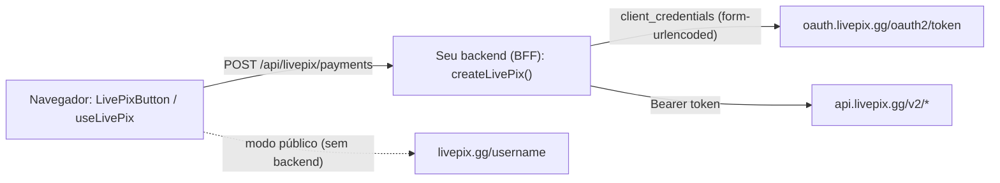

# LivePix React SDK

[](./LICENSE)
[](https://github.com/ApenasGabs/livepix-react-sdk/issues)
[](https://github.com/ApenasGabs/livepix-react-sdk/stargazers)
[](https://github.com/ApenasGabs/livepix-react-sdk/network/members)
[](https://github.com/ApenasGabs/livepix-react-sdk/graphs/contributors)
[](https://livepix.gg/apenasgabs)

## Introdução

O LivePix React SDK integra a [API LivePix v2](https://api.livepix.gg/v2) em aplicações React e Node.js. Ele é dividido em duas camadas:

| Camada | Onde roda | O que faz | Credenciais |
|---|---|---|---|
| **Core server-side** (`createLivePix`, `createApiClient`) | Node.js, Express, Next.js API Routes, Functions | OAuth2 `client_credentials`, todos os módulos v2 | `LIVEPIX_CLIENT_ID` + `LIVEPIX_CLIENT_SECRET` |
| **React client-side** (`LivePixButton`, `useLivePix`) | Navegador | Botão/hook de doação via link público ou BFF próprio | Nenhuma (apenas valores públicos) |

> [!CAUTION]
> **Nunca** coloque o `clientSecret` no frontend. Variáveis `VITE_*` / `REACT_APP_*` e props de componentes são embutidas no bundle e ficam visíveis para qualquer visitante. O SDK ignora `VITE_LIVEPIX_CLIENT_SECRET` no navegador e emite um `[LivePix Security Warning]` quando detecta um segredo no cliente.



## Instalação

```bash
npm install livepix-react-sdk
# ou
yarn add livepix-react-sdk
```

Requer React `>=16.8` e Node.js 20+ no servidor.

## Configuração

### Variáveis de ambiente

```bash
# Servidor (Node.js / BFF) — privadas, SEM prefixo VITE_/REACT_APP_
LIVEPIX_CLIENT_ID=seu_client_id
LIVEPIX_CLIENT_SECRET=seu_client_secret
# Opcionais
LIVEPIX_SCOPE="payments:read payments:write"   # padrão: todos os escopos oficiais v2
LIVEPIX_TOKEN_URL=https://oauth.livepix.gg/oauth2/token
LIVEPIX_API_URL=https://api.livepix.gg

# Navegador (React) — apenas valores públicos
VITE_LIVEPIX_USERNAME=seu_username              # modo público
VITE_LIVEPIX_PAYMENT_ENDPOINT=/api/livepix/payments  # modo BFF
# VITE_LIVEPIX_PROXY_URL=/api/livepix           # alternativa: o SDK usa <proxyUrl>/payments
```

Em Create React App, troque o prefixo `VITE_` por `REACT_APP_`.

## Uso no navegador (React)

O cliente opera em um de dois modos, escolhido automaticamente:

1. **BFF** — quando `paymentEndpoint` (ou `proxyUrl`) é informado: o hook faz `POST { amount, currency, redirectUrl }` para o seu backend e redireciona para o `redirectUrl` retornado (aceita resposta crua ou envelope `{ data }`).
2. **Público** — quando apenas `username` (ou um `redirectUrl` pré-gerado) é informado: redireciona para `https://livepix.gg/<username>`, sem backend.

URLs de redirecionamento são validadas: somente `http:`/`https:` são aceitos (bloqueia `javascript:` e `data:`).

### Modo público (sem backend)

```tsx
import { LivePixButton } from "livepix-react-sdk";

export const DonateButton = () => (
  <LivePixButton username="apenasgabs" amount={1000} label="Doar R$ 10,00" />
);
```

### Modo BFF (pagamento com valor definido)

```tsx
import { LivePixButton } from "livepix-react-sdk";

export const DonateButton = () => (
  <LivePixButton
    paymentEndpoint="/api/livepix/payments"
    amount={1000} // centavos
    currency="BRL"
    redirectUrl="https://seusite.com/obrigado"
    label="Doar R$ 10,00"
  />
);
```

### Hook `useLivePix`

```tsx
import { useLivePix } from "livepix-react-sdk";

export const Checkout = () => {
  const { livePix, createPayment, getPublicUrl, loading, error } = useLivePix({
    paymentEndpoint: "/api/livepix/payments",
  });

  if (loading) return <p>Carregando…</p>;
  if (error) return <p>Erro: {error.message}</p>;

  const handlePay = async () => {
    const { redirectUrl } = await createPayment(2500, "BRL", window.location.href);
    window.location.href = redirectUrl;
  };

  return (
    <button onClick={handlePay}>
      Pagar R$ 25,00 ({livePix?.mode === "bff" ? "BFF" : "público"})
    </button>
  );
};
```

| Retorno | Descrição |
|---|---|
| `livePix` | `{ mode: "bff" \| "public", payments.createPayment, getPublicUrl }` ou `null` |
| `createPayment(amount?, currency?, redirectUrl?)` | Resolve `{ redirectUrl, reference }` |
| `getPublicUrl()` | Link público `livepix.gg/<username>` ou `null` |
| `loading` / `error` | Estado de inicialização e erro de configuração |

#### Props de `LivePixButton`

`label`, `amount` (centavos, padrão `1000`), `currency` (padrão `BRL`), `redirectUrl`, `paymentEndpoint`, `proxyUrl`, `username`, `onClick`, `disabled`.

> `clientSecret` ainda existe na tipagem apenas como `@deprecated` para compatibilidade: é ignorado pelo hook e gera aviso de segurança.

## Uso no servidor (Node.js / BFF)

`createLivePix` lê `LIVEPIX_CLIENT_ID`/`LIVEPIX_CLIENT_SECRET` de `process.env` (ou recebe por parâmetro), obtém o token em `https://oauth.livepix.gg/oauth2/token` via `application/x-www-form-urlencoded`, renova automaticamente no `401` (retry único com `forceRefresh`) e desempacota o envelope `{ data: T }` da API v2.

### Express

```ts
import express from "express";
import { createLivePix } from "livepix-react-sdk";

const app = express();
app.use(express.json());

const livePix = createLivePix(); // ou createLivePix(clientId, clientSecret, { scope })

app.post("/api/livepix/payments", async (req, res) => {
  const { amount, currency = "BRL", redirectUrl } = req.body;
  if (!Number.isInteger(amount) || amount <= 0) {
    return res.status(400).json({ error: "amount inválido" });
  }
  try {
    const payment = await livePix.payments.createPayment(amount, currency, redirectUrl);
    res.json({ data: payment });
  } catch {
    res.status(502).json({ error: "Falha ao criar pagamento" });
  }
});

app.listen(3001);
```

### Next.js (App Router)

```ts
// app/api/livepix/payments/route.ts
import { createLivePix } from "livepix-react-sdk";

const livePix = createLivePix();

export async function POST(request: Request) {
  const { amount, currency = "BRL", redirectUrl } = await request.json();
  const payment = await livePix.payments.createPayment(amount, currency, redirectUrl);
  return Response.json({ data: payment });
}
```

### Módulos v2 disponíveis

| Módulo | Métodos |
|---|---|
| `account` | `getAccount()` |
| `payments` | `createPayment(amount, currency, redirectUrl)`, `getPayments()`, `getPayment(id)` |
| `wallet` | `getWalletBalance()`, `getWalletTransactions(currency)`, `getWalletReceivables(currency)` |
| `currencies` | `getCurrencies()` |
| `webhooks` | `getWebhooks()`, `createWebhook(url)`, `deleteWebhook(id)` |
| `messages` | `getMessages(params?)`, `createMessage(input)`, `getMessage(id)` |
| `subscriptions` | `getSubscriptions(params?)`, `createSubscription(input)`, `getSubscription(id)`, `getSubscriptionTransactions(id, params?)` |
| `subscriptionPlans` | `getSubscriptionPlans(params?)`, `createSubscriptionPlan(input)`, `getSubscriptionPlan(id)`, `updateSubscriptionPlan(id, input)`, `deleteSubscriptionPlan(id)` |
| `rewards` | `getRewards()`, `getRewardGrants(rewardId)` |
| `controls` (alias `alerts`) | `getControls()`, `updateControls(input)`, `skipAlert()`, `replayAlert()` |

```ts
const plans = await livePix.subscriptionPlans.getSubscriptionPlans();
const rewards = await livePix.rewards.getRewards();
await livePix.controls.skipAlert();
```

Para clientes HTTP customizados, use `createApiClient({ clientId, clientSecret, scope, tokenUrl, baseUrl })` e os construtores de módulo (`createPaymentApi(apiClient)`, `createRewardsApi(apiClient)`, …).

## App de exemplo

O diretório [`example/`](./example) contém uma demo Vite com os dois modos e um BFF de desenvolvimento que mantém o segredo no processo Node. Veja o [README do exemplo](./example/README.md).

```bash
yarn install && yarn example
```

## Migração da v1

| Antes (inseguro) | Agora |
|---|---|
| `VITE_LIVEPIX_CLIENT_SECRET` no `.env` do frontend | `LIVEPIX_CLIENT_SECRET` apenas no servidor |
| `<LivePixButton clientId clientSecret />` | `<LivePixButton paymentEndpoint="/api/livepix/payments" />` ou `username="..."` |
| `useLivePix({ clientId, clientSecret }).livePix.account` | `createLivePix()` no backend; o hook só cria pagamentos |
| `https://auth.livepix.gg/oauth/token` (JSON) | `https://oauth.livepix.gg/oauth2/token` (form-urlencoded) |

## Troubleshooting

1. **`Configuração do LivePix não encontrada`** — informe `paymentEndpoint`, `proxyUrl`, `username` ou `redirectUrl` (props ou `VITE_LIVEPIX_*`).
2. **`[LivePix Security Warning] Uso de clientSecret detectado no navegador`** — remova o segredo do frontend e mova a chamada para o BFF.
3. **`Credenciais da API não configuradas para uso Server-Side`** — defina `LIVEPIX_CLIENT_ID` e `LIVEPIX_CLIENT_SECRET` no ambiente do servidor.
4. **`URL de redirecionamento não retornada pelo servidor`** — o BFF deve responder `{ redirectUrl }` ou `{ data: { redirectUrl } }`.

## Desenvolvimento

```bash
yarn lint && yarn typecheck && yarn test && yarn build
```

## Contribuição

Contribuições são bem-vindas! Sinta-se à vontade para abrir issues ou pull requests no repositório.

## Licença

Este projeto está licenciado sob a [Licença MIT com Commons Clause](https://commonsclause.com/). A Commons Clause adiciona restrições ao uso comercial do software. Para mais detalhes, consulte o arquivo [LICENSE](./LICENSE).

### Nota para Contribuidores

Contribuidores devem estar cientes de que a Commons Clause restringe o uso comercial do software, mesmo que ele seja baseado na Licença MIT. Certifique-se de entender essas implicações antes de contribuir.
